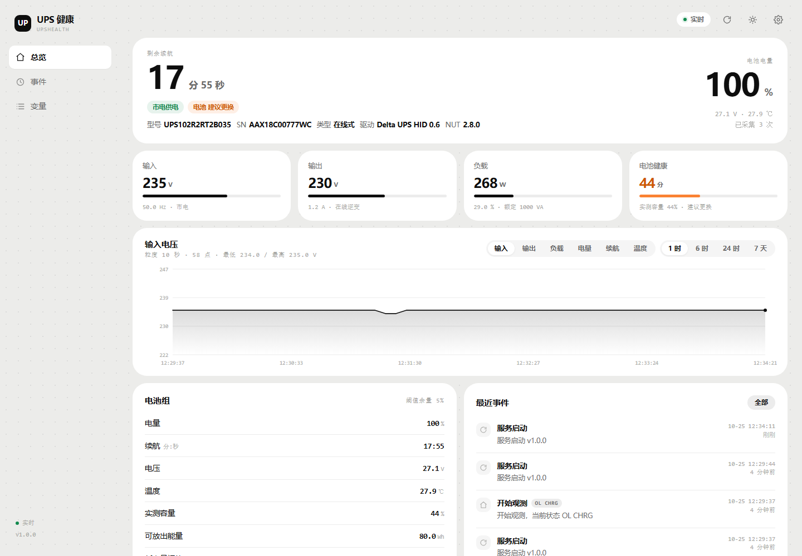
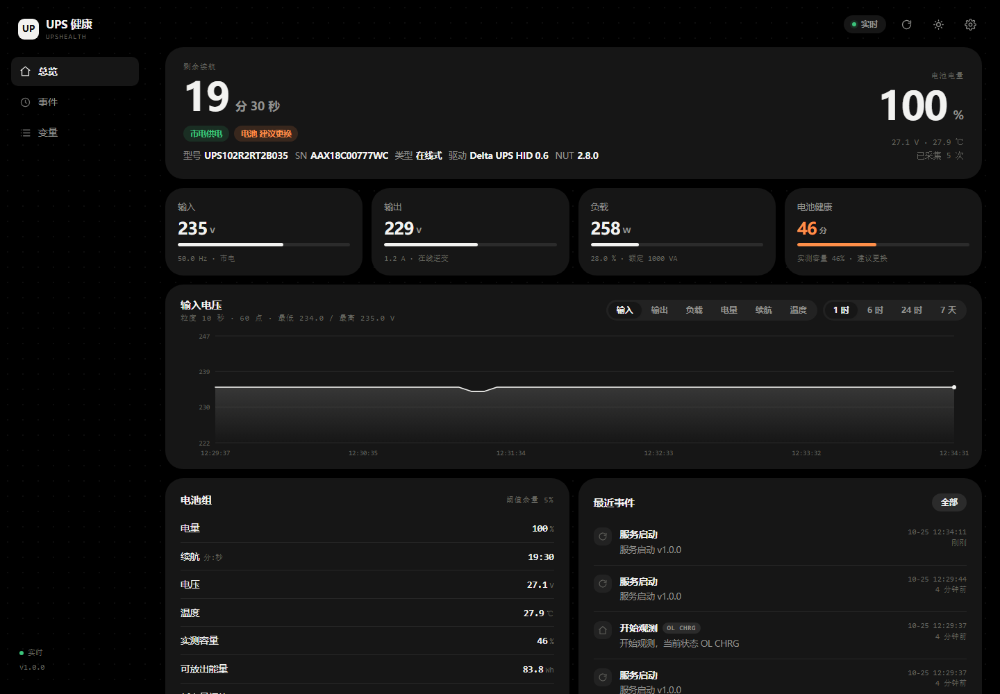
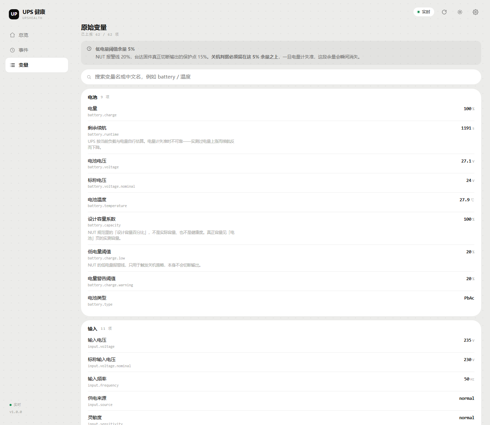
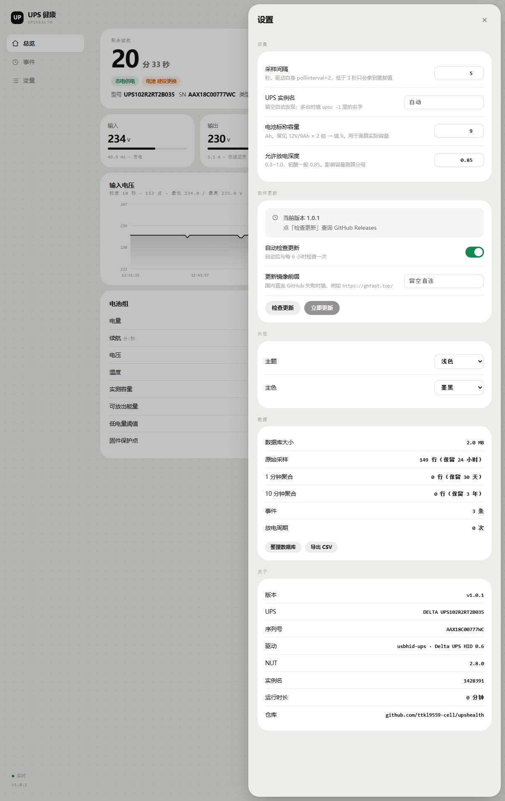
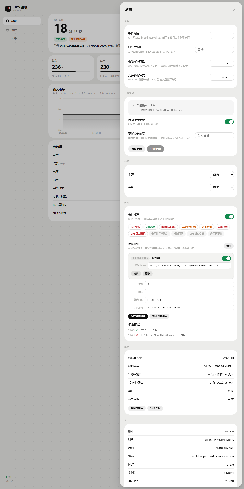

# UPS 健康 · upshealth

飞牛 fnOS 的 UPS 增强监控应用。把 NUT 实际能读到的 **62 项 UPS 变量**全部展示出来，外加飞牛原生界面没有的东西：电池实测容量与衰减评估、市电中断/切换事件台账、输入电压趋势、以及**内置在线更新**。

纯读取，不改动系统任何文件，不用碰 `upsd.users`、不用开 `killpower`、不用改 `upsmon.conf`。

---

## 为什么需要它

飞牛自带的「UPS 电源管理」页面只显示 **6 项**（厂商、型号、电量、负载、剩余时间、状态），而你这台台达 RT-1K 通过 `usbhid-ups` 实际暴露了 **62 项**：

| 原生界面 | upshealth |
|---|---|
| 电量 58% | 电量 / 电池电压 / 标称电压 / 温度 / 设计容量系数 / 低电量阈值 / 警告阈值 / 电池类型 / 剩余续航 |
| 负载 19% | 负载率 / 实际功率 W / 额定 VA / 输出电流 / 输出频率 / 输出电压 |
| — | 输入电压 / 输入频率 / 供电来源 / 灵敏度 / 高低压切换点及上下限（6 项） |
| — | 运行状态位解析（OL/OB/LB/RB/CHRG/DISCHRG/ALARM/BYPASS/CAL/OFF/OVER/TRIM/BOOST/FSD 共 14 位） |
| — | 关机/重启/启动倒计时（4 项）、驱动与固件版本、厂商扩展变量 |

顺带解决了两个飞牛原生的坑：

1. **「关机时同步」勾了会报错** —— 根因是 `/etc/nut/upsd.users` 里只有 `[monuser]` 且仅授了 `upsmon master`，没有 `actions` / `instcmds` 权限，任何 `upscmd` 都会返回 `ERR ACCESS-DENIED`。本应用不复用那条通道，自己按需只读 `upsc`，所以不需要动这个权限。
2. **UPS 关不掉输出** —— 飞牛走的是自己的「断电 60 秒就关机」策略，`upsmon` 永远看不到 `LB`，所以 `/etc/killpower` 从来不会被写；`device.conf` 里 `shutdown-ups.enabled = false`。本应用把这条链路的状态**如实记录并展示出来**（见「事件」页的 FORCED_SHUTDOWN 与放电周期统计），而不是偷偷去改它。

还有一点：飞牛自己的 `fn-ups-manager.sqlite3` 在长时间运行后会膨胀（实测 104 天到 **1.83 GB**，约 17 MB/天，无清理机制）。upshealth 用三级降采样，长期稳定在 **30 MB 左右**。

---

## 预览

| 总览（浅色） | 总览（深色） |
|---|---|
|  |  |



设置抽屉（采样、电池参数、更新、外观、关于）：



界面沿用 fnmonitor 的设计语言：26 / 14 圆角、点阵数字、九档状态色，浅色深色都跟手。

---

## 功能

### 总览

- 大字状态卡：当前运行状态、电量、剩余续航、负载、实际功率、电池温度、输入/输出电压
- **电池健康评估**：按能量守恒反算实测可用容量，给出健康分与「正常 / 关注 / 建议更换」结论
- 输入电压趋势图（1 小时 / 6 小时 / 24 小时 / 7 天 / 30 天 / 90 天可切）
- 最近事件速览

### 变量

- 62 项变量按「电池 / 输入 / 输出 / 负载 / 状态 / 定时器 / 设备 / 驱动 / 厂商扩展」分组
- 每项带中文名、单位、原始 `upsc` 键名
- 对容易误读的项内置说明（例如 `battery.capacity` 是 NUT 规范里的「设计容量百分比」，**不是**实际容量、**不是**健康度）
- 搜索 + 只看异常

### 事件

- 市电中断 / 恢复、低电量、换电池告警、过载、强制关机、放电周期
- 统计行：市电中断次数、已恢复次数、换电池告警、累计放电时长
- 首次启动记录、采集盲区（服务未运行超过 3 分钟）也会入库，避免"看起来一直很健康"的假象
- CSV 导出（带 BOM，Excel 直接开不亂码）

### 通知推送

断电那一刻手机就该响，而不是等你回来看图表。

- **6 种通道**：邮件 SMTP、企业微信机器人、钉钉机器人、Bark（iOS）、Server 酱、通用 Webhook
- **事件可选**：断电 / 恢复 / 低电量 / 需换电池 / 告警 / 过载 / 强制关机 / 电量跳变 / 观测盲区 / 设备变化 / 应用更新
- **去抖 + 限流**：同类事件 60 秒内只发一次，全局每分钟最多 8 条，状态抖动不会刷屏
- **静音时段**：`23:00-07:00` 只压制警告级，断电这类严重事件照发
- **密钥打码**：SMTP 密码、Webhook 里的 `key`/`token`、Bark key 在接口里一律显示 `***`，改别的字段不会把密钥冲掉
- **发送记录**：每条成功还是失败、失败原因是什么，界面上直接看
- 纯读取，不需要给 NUT 提权，也不改动飞牛任何文件



### 内置更新

- 设置页「检查更新」→ 定位最新 Release → 下载 `.fpk` → **SHA256 校验** → 解包 → **对新版 `server.py` 做语法编译检查**（编译不过直接拒绝，不会把自己更坏）→ 备份旧文件 → 覆盖 → 自动重启
- 版本发现三级链路，**前两级完全不消耗 GitHub API 配额**：`releases.atom` → `/releases/latest` 的 302 跳转 → `api.github.com` 兜底。拿到 tag 后安装包地址按命名规则直接推导，因此 API 被限流（未登录每出口 IP 60 次/小时）也照常更新
- 全程只改本应用自己的目录，**不需要回应用中心重新安装**
- 支持自定义镜像前缀（如 `https://ghfast.top/`），应对直连 GitHub 慢
- 注：应用中心列表里的版本号取自安装时的 `manifest`，应用内更新不会去改它（那属于飞牛的应用注册信息）。真实版本以应用内「关于」为准

---

## 安装

### 方式一：应用中心手动安装（推荐）

1. 到 [Releases](../../releases/latest) 下载对应架构的包：
   - x86_64（绝大多数飞牛机器）：`upshealth_<版本>_x86.fpk`
   - ARM64：`upshealth_<版本>_arm.fpk`
2. 飞牛 → 应用中心 → 右上角「手动安装」→ 选 fpk
3. 装完从桌面图标或 `http://<NAS-IP>:8778` 打开

装好之后，**后续升级只需在应用内点「检查更新」**，不用再下载 fpk。

### 前置条件

- 飞牛已识别到 UPS（`upsc -l` 能列出设备）。原生「UPS 电源管理」能用就说明满足。
- `upsc` 可执行（飞牛自带 NUT 2.8.0）
- 应用以 root 运行（需要读 NUT socket，这是飞牛第三方应用的正常做法）

---

## 已验证环境

| 项目 | 值 |
|---|---|
| 系统 | 飞牛 fnOS 1.2.0800 |
| 机器 | Dell R730XD |
| UPS | 台达 Delta RT-1K（`UPS102R2RT2B035`），USB 直连 |
| 驱动 | `usbhid-ups` + `Delta UPS HID 0.6` |
| NUT | 2.8.0 |
| 变量数 | 62 / 62 全部读出 |

其他品牌（APC / 山特 / 伊顿等）只要是标准 NUT 驱动，理论上都能用；未知变量会自动落到「厂商扩展」分组，不会丢。

---

## 数据与隐私

- **不联网上报任何数据**。唯一的对外请求是「检查更新」时访问 `api.github.com`（可关闭，可走镜像）。
- 数据库在 `/vol1/@appdata/upshealth/upshealth.db`，SQLite WAL 模式。
- 采样间隔默认 10 秒（可调 3–300 秒）。三级降采样：
  - 原始 10 秒 → **保留 24 小时**
  - 1 分钟 → **保留 30 天**
  - 10 分钟 → **保留 3 年**
  - 稳态体积约 **30 MB**。
- 卸载时数据库/日志/备份不自动删除（飞牛在卸载确认后清理），避免误删历史。

---

## 安全

- 后端零第三方依赖，**只用 Python 3 标准库**。
- 所有写操作走 `POST /api/*`，并做双重 CSRF 门：必须 `Content-Type: application/json` **且**带 `X-UPS-Request: 1` 头。跨站表单无法伪造。
- 静态路由做路径穿越防护（`..` 直接拒绝，且校验真实文件存在后才返回）。
- 更新包强制 SHA256 校验 + 语法预检。

---

## 电池健康怎么算的

飞牛的「电量 58%」和「剩余 17 分钟」在多数 UPS 上是两套互相独立的估算模型，甚至会打架（实测出现过电量 57→58→59 持续上升，同时剩余续航 672→668→668 秒基本不动）。所以只看百分比判断不了电池好坏。

upshealth 用能量守恒从**真实功率**反推可用能量：

```
usable_wh = ups.realpower × (battery.runtime / (battery.charge / 100)) / 3600
容量%     = usable_wh / (标称电压 × 电池Ah × 放电深度DOD) × 100
```

标称电压从 `battery.voltage.nominal` 自动读；**电池 Ah 和 DOD 需要你自己在设置里填**（铭牌上印的，常见 7Ah / 9Ah / 12Ah，DOD 一般 0.8）。这两个值不填，健康分只能给相对趋势；填了才是绝对值。

健康分还会参考：满充后电压是否达标、放电曲线是否陡降、历史放电周期的一致性。

> 注意：这是**估算**，不是电池分析仪。它能在电池明显衰减时提前告诉你，但不能替代实测放电。

---

## 开发

```bash
python build_fpk.py            # 构建当前平台包（默认 x86）
python build_fpk.py --arm      # arm64
python build_fpk.py --both     # 两个都构建
```

产物在 `dist/`，同时生成 `.sha256` 供内置更新校验。打包脚本纯 Python，不依赖 `tar`/`md5sum` 等平台工具，Windows 上也能直接跑出能被飞牛接受的包。

自检（CI 会跑，本地也能跑）：

```bash
python tools/namelint.py app/server.py   # 未定义全局名，抓 NameError 隐患
python tools/detect_test.py              # 用伪造读数走遍所有状态分支
python tools/layout_test.py              # 模拟 fpk 真实布局做冒烟
```

`detect_test.py` 是刻意加的：有些分支（例如状态位跳变）只在特定条件下执行，编译期和肉眼都发现不了。它把每个分支都强制走一遍。

四项自检（CI 每次构建前都会跑）：

```bash
python tools/namelint.py app/server.py build_fpk.py   # 未定义全局名
python tools/detect_test.py                            # 事件检测分支全覆盖
python tools/layout_test.py                            # fpk 真实布局冒烟
python tools/notify_test.py                            # 通知推送端到端（假 SMTP / 假 Webhook）
```

打 tag 推送即自动构建并发布 Release：

```bash
git tag v1.0.1 && git push origin v1.0.1
```

---

## 卸载

应用中心 → UPS 健康 → 卸载。历史数据库默认保留在 `/vol1/@appdata/upshealth/`，需要彻底清理时手动删目录。

---

## License

MIT
